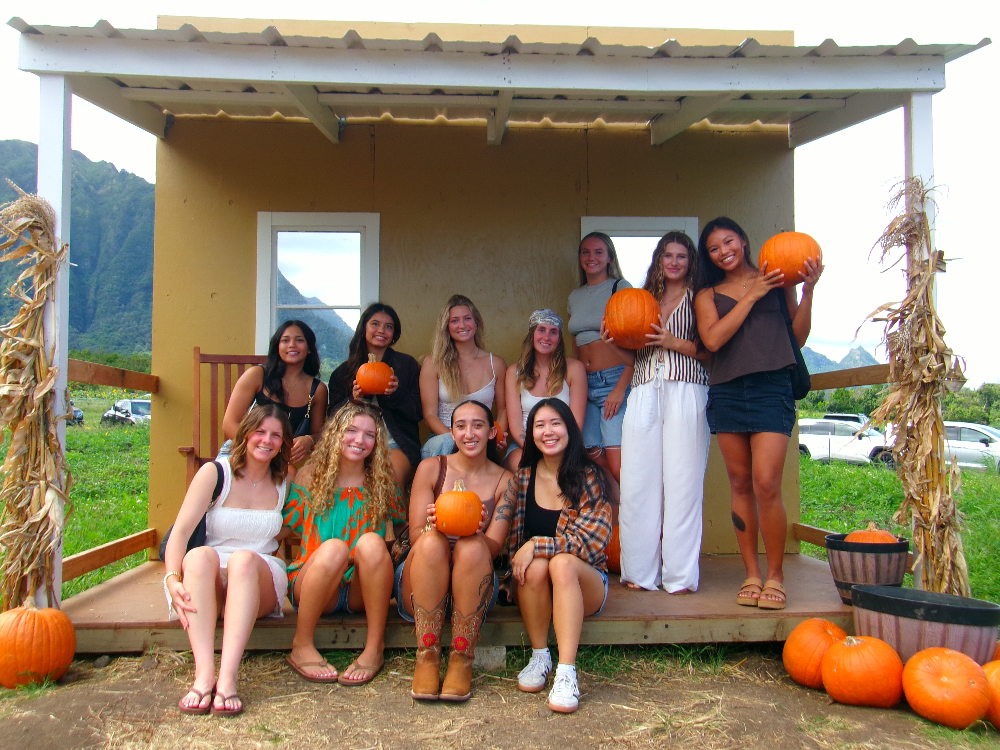
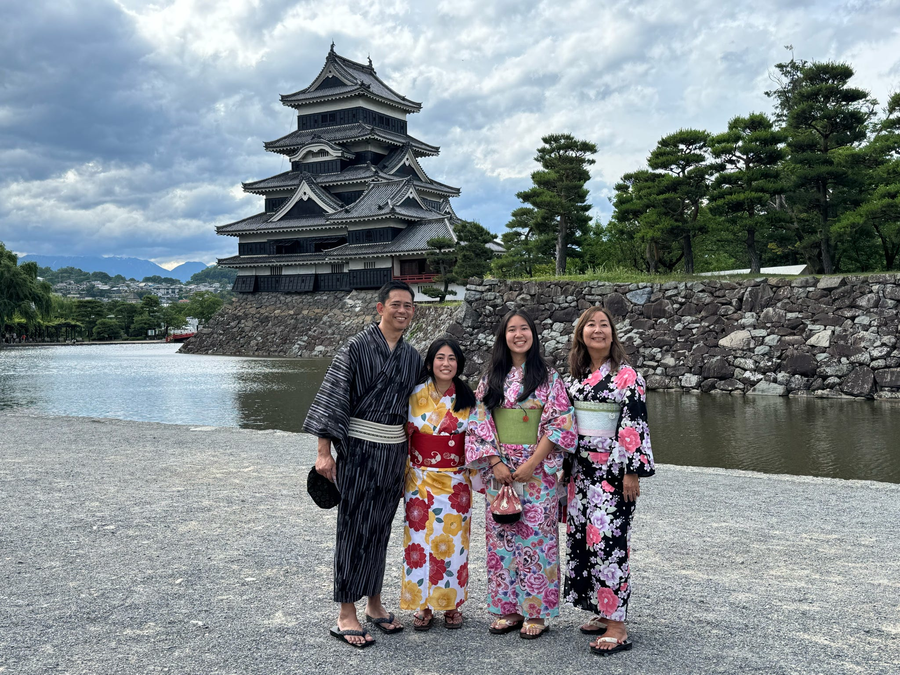
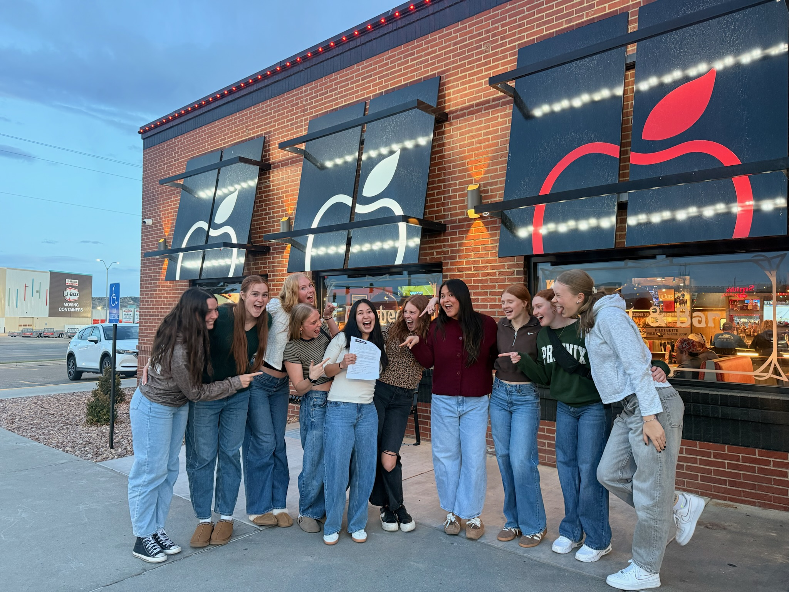
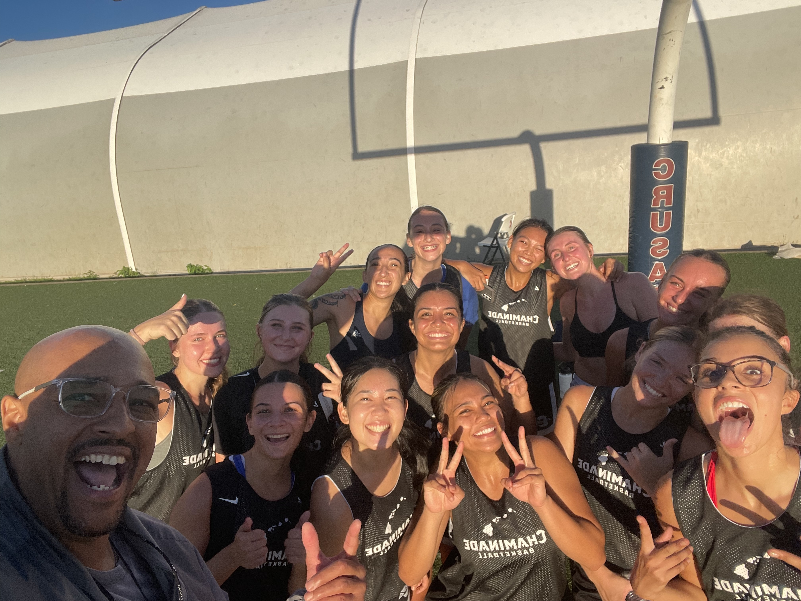

I was born and raised in Kahului, Maui. Growing up, I was an active kid who played a variety of sports. I come from a tennis family, but ended up falling in love with basketball. In high school, I was on the MIL first team for basketball and tennis. My senior year I won Most Outstanding Female Athlete at Maui High School. Today, I am a Junior at Chaminade Univeristy, majoring in data science, and a captain for the women's basketball team.

### Journey to Chaminade

After graduating high school, I burnt out of basketball so I decided to attend Chaminade and play on the women’s tennis team. I ended up missing basketball and rediscovered my love for the game, so the following year, I transferred to Western Wyoming Community College, where I played two years of junior college basketball and earned my associate degree. When my sophomore season ended, I still wanted to keep playing. So I reopened my recruitment to try and attend a four-year institution. I ultimately committed back to Chaminade, where I now play basketball and major in Data Science.

### Future Plans

Right now, I don't have any set plans after I graduate. As I'm studying data science, I would be interested in applying it to environmental issues or sports analytics. I am also really interested in coaching. I realized that whatever I do, my main goal is to help others. I have tried many different majors in college before ending up on data science, but one thing that never changed for me is my goal to help other people and make a difference.

### Fun Facts

Basketball takes up most of my time, but I also love to travel, read, and spend time with friends and family. Some fun facts about me are that I can solve a rubix cube, I know how to do the worm, and I can do magic tricks!

[{width="40" fig-alt="Chaminade University Women's Basketball Roster"}](https://goswords.com/sports/womens-basketball/roster/jordyn-luna/7058)

:::::::: {#photoCarousel .carousel .slide data-bs-ride="carousel" style="max-width: 600px; margin: auto;"}
::::::: carousel-inner
::: {.carousel-item .active}
{.d-block .w-100 fig-alt="Description of photo 1"}
:::

::: carousel-item
{.d-block .w-100 fig-alt="Description of photo 2"}
:::

::: carousel-item
{.d-block .w-100 fig-alt="Description of photo 3"}
:::

::: carousel-item
{.d-block .w-100 fig-alt="Description of photo 4"}
:::
:::::::

```{=html}
<button class="carousel-control-prev" type="button" data-bs-target="#photoCarousel" data-bs-slide="prev">
  <span class="carousel-control-prev-icon"></span>
</button>
<button class="carousel-control-next" type="button" data-bs-target="#photoCarousel" data-bs-slide="next">
  <span class="carousel-control-next-icon"></span>
</button>
```
::::::::
